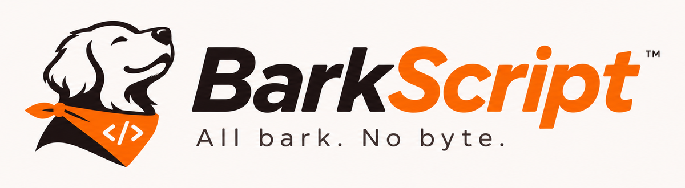

<p align="center">
  
</p>

<p align="center">
  <a href="https://mpge.github.io/barkscript/"><b>Playground</b></a> ·
  <a href="docs/LANGUAGE.md"><b>Language guide</b></a> ·
  <a href="examples"><b>Examples</b></a> ·
  <a href="docs/GRAMMAR.md"><b>Grammar</b></a>
</p>

<p align="center">
  <a href="https://github.com/mpge/barkscript/actions/workflows/ci.yml"></a>
  <a href="https://www.npmjs.com/package/barkscript"></a>
  <a href="LICENSE"></a>
</p>

**BarkScript is a programming language written in dog commands.** It has a real lexer, parser,
type checker and compiler, and it turns `.bark` files into plain, readable JavaScript.

What if a dog invented JavaScript? Roughly this:

```bark
sit dog = "Walter"
sit treats = 3

woof "Who's a good boy?"

fetch giveTreat()
    if treats > 0
        woof "Here you go"
        treats = treats - 1
    otherwise
        woof "No more treats"
    end
end

again 3
    come here giveTreat()
end

play dead
```

`bark compile` turns that into:

```js
let dog = "Walter";
let treats = 3;

console.log("Who's a good boy?");

function giveTreat() {
  if (treats > 0) {
    console.log("Here you go");
    treats = treats - 1;
  } else {
    console.log("No more treats");
  }
}

for (let i = 0; i < 3; i++) {
  giveTreat();
}

process.exit(0);
```

## Install

```sh
npm install -g barkscript
bark run hello.bark
```

Or without installing: `npx barkscript run hello.bark`. Needs Node.js 20 or newer.

## The words

| BarkScript | Means | | BarkScript | Means |
|---|---|---|---|---|
| `woof` | print | | `again` | loop |
| `sit` | variable | | `no` | break |
| `stay` | constant | | `leave it` | continue |
| `fetch` | function | | `wait` | delay |
| `come here` | call | | `beg` | read input |
| `drop it` | return | | `play dead` | exit |
| `if` / `otherwise` | if / else | | `end` | end a block |
| `good boy` | true | | `bad dog` | false |
| `empty bowl` | null | | `and` `or` `not` | logic |

Strings interpolate (`"Hi {name}"`), lists and objects are JavaScript's, and JavaScript
globals like `Math` and `JSON` just work. The [language guide](docs/LANGUAGE.md) covers all of
it in about ten minutes.

## Errors that tell you what happened

The compiler checks your whole program before it runs a line of it.

```text
dog.bark:12

  11 | sit treats = 3
  12 | fetch
     | ^^^^^

You told Walter to FETCH,
but never told him what to fetch.

hint: name the fetch, like `fetch giveTreat()`
```

```text
dog.bark:18

  17 | sit treats = 3
  18 | sit double = good boy * 2
     |              ^^^^^^^^

"good boy" is not a number.
```

Typos get suggestions, `stay` can't be reassigned, blocks that never `end` are caught, and
JavaScript habits (`return`, `&&`, `true`, `;`) get pointed at their BarkScript words.

## CLI

```sh
bark run guess.bark                   # compile and run
bark compile fizzbuzz.bark            # write fizzbuzz.js next to it
bark compile fizzbuzz.bark --stdout   # or print it
bark check *.bark                     # just look for problems
```

More in [docs/CLI.md](docs/CLI.md), including the JavaScript API.

## Examples

[hello](examples/hello.bark) · [treats](examples/treats.bark) · [fizzbuzz](examples/fizzbuzz.bark) ·
[fibonacci](examples/fibonacci.bark) · [guess the number](examples/guess.bark) ·
[walk](examples/walk.bark) (async) · [kennel](examples/kennel.bark) (lists, objects, closures)

## Documentation

| | |
|---|---|
| [Language guide](docs/LANGUAGE.md) | Every feature, with examples the test suite runs |
| [Grammar](docs/GRAMMAR.md) | The formal EBNF grammar and semantics |
| [CLI and API](docs/CLI.md) | `bark run`, `compile`, `check`, and using the compiler from code |
| [VS Code](editors/vscode) | Syntax highlighting (a TextMate grammar, so it works elsewhere too) |
| [Contributing](CONTRIBUTING.md) | How the compiler is built and how to add to it |

## License

MIT
